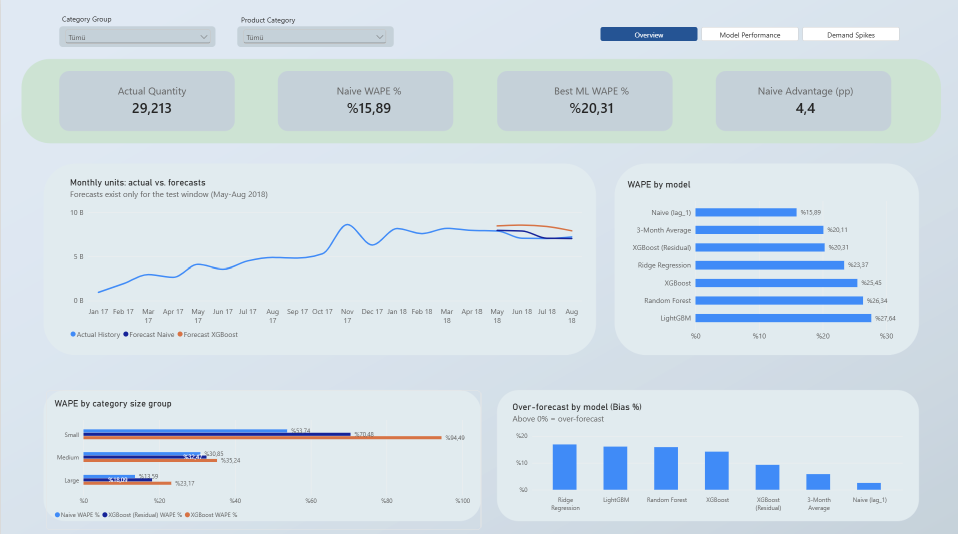
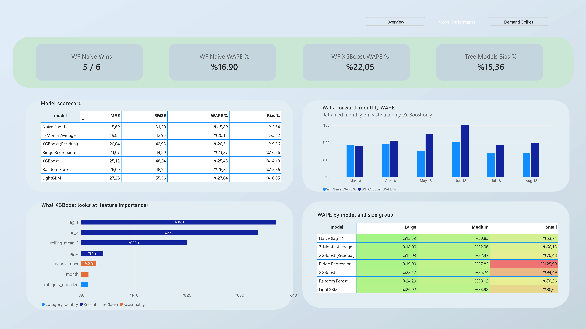
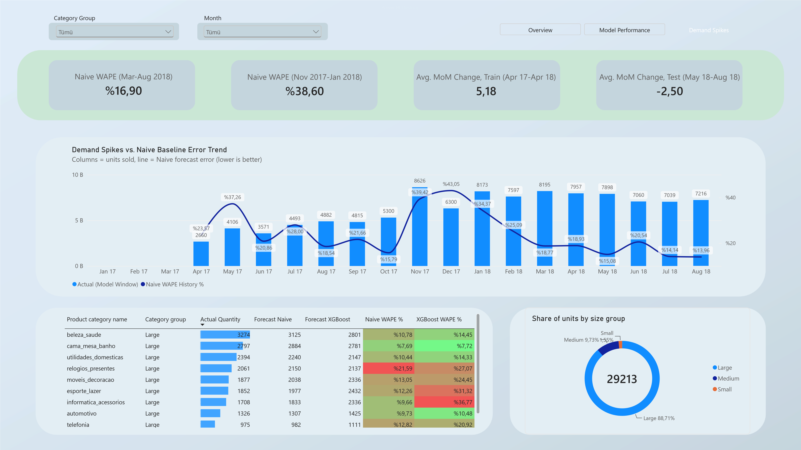

# Olist E-Commerce: Category-Level Monthly Demand Forecasting

An end-to-end demand forecasting pipeline and executive Power BI dashboard built on the Brazilian Olist e-commerce dataset (`OlistDB`). This project evaluates and compares classical baseline methods against machine learning regression models (Random Forest, XGBoost, LightGBM, and Ridge) to predict monthly category-level product sales.

> **Note on Notebook Language:** The Jupyter Notebook narrative is written in Turkish; please refer to this README for the complete English project summary.

---

## 📊 Executive Dashboard Preview

The interactive Power BI dashboard (`olist_forecast_dashboard.pbix`) consists of 3 comprehensive pages. Below are the default views with all slicers set to **"All / Tümü"**:

### Page 1: Overview & Actual vs. Forecast Performance

### Page 2: Model Performance & Walk-Forward Validation Metrics

### Page 3: Demand Spikes & Category Trends

---

## 🔍 Key Findings & Insights

1. **Baseline Dominance in Stable Regimes:** During stable periods (e.g., Mar–Aug 2018), the simple **Naive baseline (Lag-1)** outperformed complex machine learning models, achieving a lower WAPE (**15.9%** vs. **25.5%** for XGBoost).
2. **The ML Over-Forecasting Bias:** Tree-based models and Ridge regression over-forecasted total test demand by ~14–17%. Feature importance analysis revealed that models heavily relied on historical lags (`lag_1`, `lag_2`, `rolling_mean_3`), mistakenly extrapolating a positive historical growth trend into a flat test period.
3. **Vulnerability to Demand Shocks:** While Naive rules excel during stationary months, their error spikes dramatically during seasonal demand shocks (e.g., Black Friday in November 2017 reached **39.4%** WAPE), proving that static rules fail during extreme promotional spikes.

---

## ⚙️ Methodology & Architecture

* **Data Engineering:** Extracted from SQL Server (`vw_OlistMasterAnalysis.sql`), cleaned, and transformed into a balanced monthly category matrix (`1480 rows = 20 months × 74 categories`) using `pivot_table(fill_value=0)` to prevent rolling-window offset bugs.
* **Temporal Cross-Validation:** Utilized strict chronological splits and `TimeSeriesSplit` to prevent data leakage (Training: Apr 2017 – Apr 2018; Test: May 2018 – Aug 2018).
* **Evaluation Metrics:** **WAPE** (Weighted Absolute Percentage Error), **MAE** (Mean Absolute Error), and **RMSE** (Root Mean Squared Error).

---

## ⚠️ Limitations

* **Short History:** The dataset spans 20 months; seasonality is learned from only a single annual cycle.
* **Lack of External Regressors:** Features do not include marketing spend, competitor pricing, or macroeconomic indicators.
* **Test Period Nature:** The evaluation window is largely stationary and does not capture structural market shifts.

---

## 🚀 How to Run the Project

### 1. Prerequisites & Environment
Ensure you have Python installed along with Anaconda or a virtual environment. Install the required libraries using:

    pip install -r requirements.txt

### 2. Database Setup & Notebook Execution
1. Restore the Olist database in SQL Server and execute the view script located in `sql/vw_OlistMasterAnalysis.sql`.
2. Open Jupyter Notebook:

    jupyter notebook notebooks/OlistAnalysis.ipynb

3. Ensure your local SQL Server connection string matches `.\SQLEXPRESS` with trusted Windows authentication. Run all cells (`Kernel -> Restart & Run All`) to regenerate outputs and the exported Excel summary.

### 3. Power BI Dashboard
* Open `dashboard/olist_forecast_dashboard.pbix`.
* *Note: Data is embedded directly within the `.pbix` file; refreshing underlying database connections requires re-pointing the Excel source (`data/olist_forecast.xlsx`).*
* Alternatively, a static PDF export is available at `dashboard/olist_forecast_dashboard.pdf`.

---

## 📜 Data Source & License
* **Dataset:** Public Brazilian E-Commerce Public Dataset by Olist (hosted on Kaggle).
* **License:** Creative Commons Attribution-NonCommercial-ShareAlike 4.0 International ([CC BY-NC-SA 4.0](https://creativecommons.org/licenses/by-nc-sa/4.0/)).
